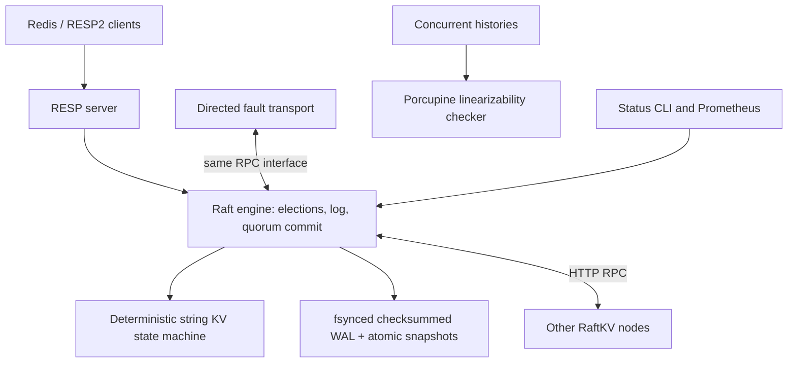

# RaftKV

A Redis-compatible string store in Go, backed by an original implementation of
Raft. It supports elections, replicated commands, durable crash recovery,
snapshots, fault injection and concurrent linearizability testing. The emphasis
is understandable systems code and explicit failure semantics.

This is an undergraduate systems project, not a production Redis replacement.

## Run it

Requires Go 1.24+, Python 3 for the process scripts, and `redis-cli` for the demo.
macOS and Linux are supported. No services or containers are required.

```bash
make check               # unit + distributed tests, race detector, go vet
make cluster             # three background processes; data/logs in run/
./bin/raftkv status
python3 scripts/cluster.py leader
```

Commands must go to the current leader. Discover its address before connecting:

```bash
ADDR=$(python3 scripts/cluster.py leader)
redis-cli -h "${ADDR%:*}" -p "${ADDR##*:}" SET hello world
redis-cli -h "${ADDR%:*}" -p "${ADDR##*:}" GET hello
```

Node1 listens on 6379, node2 on 6380 and node3 on 6381. A command sent to a follower
returns `MOVED <leader-client-address>`, or `CLUSTERDOWN` when no leader is known.
This is an informative error, not the Redis Cluster routing protocol; ordinary
RESP2 clients can connect directly to the leader.

```bash
make demo                # writes, SIGKILL leader, reelection, restart, convergence
make stop                # stops only processes started by the script
make chaos               # 10 seconds of concurrent clients and network/crash faults
./bin/raftkv-chaos -nodes 5 -duration 30s -clients 8 -seed 2026
make bench               # 3/5 nodes, 1/8 clients, latency and recovery measurements
```

The demo leaves the cluster running. Data persists across `make stop` and
`make cluster`. To start fresh, stop it first, then remove `run/node1`,
`run/node2` and `run/node3`. The supplied configurations use JSON to avoid a YAML
dependency. For a five-process cluster, run `make cluster5`, `make demo5` and `make stop5`.
These use `configs/five/`, client ports 6390–6394, RPC ports 7101–7105 and
independent data in `run/five/`. Inspect it with
`./bin/raftkv status -config configs/five/node1.json`. Do not change membership on existing data.

## Architecture



- `cmd/raftkv`: node process and status/cluster/info CLI.
- `internal/raft`: protocol state, replication workers, ordered application.
- `internal/storage`: framed checksummed WAL, locking, atomic compaction.
- `internal/statemachine`: deterministic Redis string semantics and binary snapshots.
- `internal/resp`, `internal/server`: bounded RESP2 codec and server lifecycle.
- `internal/transport`: HTTP RPC and instrumentable directed network.
- `internal/harness`, `internal/history`, `tests`: disk-backed fault workloads and checker.
- `cmd/raftkv-chaos`, `cmd/raftkv-bench`: reproducible workload tools.

## How it works

**Elections.** Randomized deadlines and persisted votes select a majority-backed
leader. Higher terms cause step-down. Candidates must have an up-to-date log.
Leaders send heartbeats and append a current-term no-op on election.

**Replication and commits.** A leader fsyncs entries, then replicates with
AppendEntries. Followers repair conflicting uncommitted suffixes and persist
before acknowledging. A majority can advance commit only through a current-term
entry. Application is ordered and deterministic.

**Reads.** Data reads also enter the Raft log. Their application after quorum
commit gives them a linearizable position among writes. This trades read
performance for a compact, defensible implementation without leases or subtle
ReadIndex round tracking.

**Recovery.** Every vote, term/log change and commit checkpoint is fsynced.
Recovery verifies CRC32 records, truncates incomplete EOF tails, fails closed
on checksum corruption, restores the snapshot and replays committed entries.
Uncommitted entries remain in the log until committed or repaired.

**Snapshots.** A configurable applied-entry threshold compacts the log.
Snapshot, hard state and retained suffix are atomically checkpointed together.
InstallSnapshot brings followers that missed the compacted prefix up to date.

## Commands and consistency

Supported: `PING [message]`, `ECHO message`, `GET`, `SET`, multi-key `DEL`, `EXISTS`, `INCR`,
`MGET`, `MSET`, `DBSIZE`, `INFO` and `ROLE`. Keys and values are arbitrary byte
strings. RESP arrays/bulk strings, nulls, integers, errors and pipelining work.
`SET` options, TTLs and RESP3 are outside scope; configure clients for RESP2. ECHO also supports redis-cli --pipe completion probes.

All data commands are linearizable and require a live majority: two of three
or three of five configured nodes. MSET and multi-key DEL are atomic commands.
An isolated old leader cannot commit writes or return stale data reads. If the
majority is unavailable, commands fail or time out; the store does not offer
follower-local reads. Local PING, ECHO, INFO, ROLE and admin/metrics endpoints are
informational and may be stale.

A timeout, leadership change or stopped-node error can mean an **unknown write
outcome**. The entry may later commit. There are no request IDs or exactly-once
retries; blindly retrying INCR can apply it twice. Do not infer failure from a
missing reply.

The failure model is crash/restart and arbitrary delayed, dropped, duplicated,
reordered or partitioned messages between trusted members. Safety assumes a
fixed identical membership, no Byzantine peers, and storage honoring fsync and
atomic rename. Recovery detects corruption; it does not repair damaged disks.

## Observe it

```bash
./bin/raftkv status
./bin/raftkv cluster
./bin/raftkv info
curl http://127.0.0.1:7001/status
curl http://127.0.0.1:7001/metrics
```

Status includes role, term, leader, commit/applied indexes, retained log length,
snapshot index, per-follower lag, elections, received RPCs and a SHA256 state
digest. Prometheus output includes these metrics plus command totals, error
counts, average throughput since startup and a latency histogram. Lifecycle,
leader changes and storage errors use structured logs. State digests help the
process demo verify identical state without allowing follower-local GET.

## Testing

`go test ./...`, `go test -race ./...` and `go vet ./...` work directly with a
writable Go cache. The Makefile places Go caches in `/tmp` for restricted local
environments. Tests include:

- elections, heartbeat stability, freshness checks and no double voting;
- majority commits, current-term restrictions, stale responses and conflicting logs;
- minority isolation, asymmetric links, loss, duplicate and reordered delivery;
- durable votes/logs, whole-cluster restart, torn WAL records and corrupt records;
- snapshot restore, stale snapshot rejection and severely lagging follower transfer;
- concurrent GET/SET/DEL/INCR histories with leader changes, crashes and delays.

The standalone chaos tool runs actual Raft engines and disk WALs in one process
with the simulated network. It heals links, restarts nodes, checks convergence,
records histories to `run/history.json` and events to `run/events.jsonl`, and runs [Porcupine](https://github.com/anishathalye/porcupine).
It retains ambiguous requests as pending possible mutations. The model is
independent of the production state machine and tests that deliberate stale
reads and duplicate increments are rejected. Checker timeouts are failures,
not successful validations. Multi-key commands are outside the history model.

Seeds reproduce workload choices and link decisions, not goroutine scheduling.
These tests provide evidence, not a formal proof. To stress a campaign:

```bash
go test -race ./tests -run TestChaosLinearizability -count=5 -v
./bin/raftkv-chaos -duration 60s -clients 8 -nodes 5 -seed 123
./bin/raftkv-chaos -check run/history.json
```

## Benchmarks

Actual measured results and the raw report are in [docs/benchmarks.md](docs/benchmarks.md)
and [docs/benchmark.json](docs/benchmark.json). The executed checks are recorded
in [docs/verification.md](docs/verification.md). No throughput target is claimed.
The tool measures the consensus and synchronous disk path using simulated
in-process RPC. It excludes RESP, HTTP encoding and real network latency.
It also measures leader crash through the next successful write, follower log
replay, and snapshot catch-up. See the report for machine, operation counts,
errors and latency percentiles.

## Engineering decisions and limitations

Static membership keeps configuration safety and recovery studyable. HTTP JSON
avoids code generation. One Raft mutex makes state ownership explicit; network
I/O runs outside it and persistence inside it. Snapshots and log suffixes share
one atomic checkpoint, avoiding an unsafe two-file update. Logged reads avoid
clock assumptions and complex read-round bookkeeping.

The WAL stores complete checkpoints rather than granular mutations. Every
acknowledged change fsyncs, and there is no group commit. This causes write
amplification and low throughput; both reads and writes incur disk latency.
Large state also makes snapshotting and status digests expensive. Snapshots
transfer as a single bounded request (256 MiB maximum), and RESP commands are
limited to 8 MiB and 1,024 arguments.

Pre-vote and check-quorum are absent: an isolated leader may still report its
local role as leader, and an isolated follower can inflate terms. Quorum-backed
commands preserve safety, but availability can suffer. The chaos scheduler is
instrumentable, not exhaustive; in-process crash tests do not interrupt fsync
instructions. The demo separately verifies SIGKILL recovery. There is no
admission control, authentication, TLS, Redis Cluster protocol, dynamic
membership, expiration or durable client-session deduplication.

Read [docs/design.md](docs/design.md) for protocol invariants, crash boundaries,
alternatives and the reasoning behind these tradeoffs. Start studying the code
with `internal/raft/node.go`, `internal/raft/snapshot.go`,
`internal/storage/wal.go`, `internal/transport/sim.go` and
`internal/history/history.go`.
