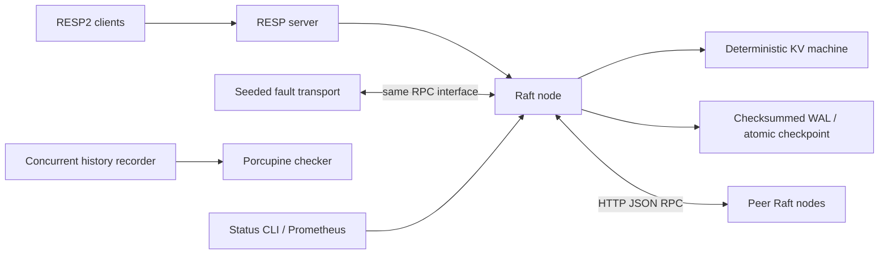

# RaftKV design

## Goals and non-goals

RaftKV is a studyable Go implementation of static-membership Raft with a Redis
string interface, durable recovery and executable failure tests. Its main goal
is preserving acknowledged operations through leader changes. The implementation
uses no consensus library. Porcupine is the only third-party Go dependency and
is used for history checking.

Non-goals include Redis Cluster, dynamic membership, transactions, expiration,
secondary data structures, authentication, TLS, Byzantine fault tolerance and
production-scale storage performance.

## Architecture



The `raft` package owns the log, hard state, machine and ordered application.
`statemachine` has no network, clocks or concurrency. `storage` accepts opaque
checkpoints, so it cannot change consensus state. HTTP and simulated transports
implement the same three RPCs. The RESP layer validates framing and translates
results; it never accesses KV data directly.

## State and invariants

Durable state is current term, voted-for, a contiguous indexed log, committed
index and a snapshot with its last included index and term. Commit persistence
is an additional convenience, beyond Raft's required term, vote and log.
Volatile state includes role, known leader, election deadline, applied index,
per-follower next/match indexes and pending client result channels.

Key invariants:

- A term increase clears the vote and reaches stable storage before a reply.
- A vote is durable before granting it. A candidate's final log term, then
  index, must be at least as recent as the voter's.
- Leaders append only. Followers replace a conflicting suffix only above the
  committed index. Indexes are absolute across compaction.
- A leader advances commit using a majority only for an entry in its current
  term. Older entries become committed through that entry, never through a
  replica count alone. A new leader appends a no-op.
- An AppendEntries response acknowledges only the request's matching prefix.
  A heartbeat cannot accidentally commit a divergent suffix that happens to
  remain in the follower's log.
- Every client command is applied in increasing index order, exactly once per
  committed log position. Application is deterministic, including error results.
- RPC responses are fenced by current role and the term of the sending request.
  Even a stale response reporting a higher term causes a step-down.
- Snapshots cover only applied, committed state. Recovery never applies an
  uncommitted tail.

There is one replication worker per follower. Its serialized requests avoid
out-of-order nextIndex updates; unrelated links and election RPCs remain
concurrent. Failed AppendEntries replies provide a conflict index; catch-up
uses batches of at most 64 entries. A follower behind the leader's compacted
prefix receives InstallSnapshot.

## Elections

Production election deadlines are randomized between 300 and 600 ms, with
50 ms heartbeats. Test harness nodes use 180–360 ms and 30 ms heartbeats.
A candidate durably increments its term and votes for itself before sending
parallel requests. A majority wins. Valid leader RPCs and granted votes reset
the election deadline. A higher term always demotes a node.

Pre-vote and check-quorum are not implemented. An isolated leader can retain
its local `leader` role until learning a higher term. This status does not give
it authority to serve commands: it cannot commit without a majority. A noisy
isolated follower can increase terms and disrupt availability after healing.
These are liveness tradeoffs, not permission to return stale values.

## Write path

1. RESP parsing yields a binary-safe command. Syntax errors are rejected before
   proposing an entry.
2. A follower returns `MOVED <client-address>` when it knows the leader, or
   `CLUSTERDOWN no known leader` otherwise.
3. The leader copies the command, appends it and fsyncs the durable checkpoint.
4. Per-peer workers replicate it. Followers validate the preceding index/term,
   repair conflicting suffixes and fsync changes before successful replies.
5. A current-term majority advances commit. The leader fsyncs the new commit
   checkpoint, applies commands in order, then returns the deterministic result.
6. Subsequent replication carries the commit index to followers.

`MSET` and multi-key `DEL` are each one log entry, so their changes are atomic.
Integer parsing and overflow errors are state-machine results: a syntax-valid
`INCR` can be committed and still return a Redis error without changing data.

The linearization point of a successful operation is ordered application on
the leader, after the quorum commit. A leadership change can interrupt the
response without undoing the entry. Such an error has an **unknown outcome**.
There is no client-session deduplication; retrying `INCR` can increment twice.

## Read path

`GET`, `MGET`, `EXISTS` and `DBSIZE` are also commands in the replicated log.
The result is evaluated when the committed entry is applied. A read therefore
has a quorum-confirmed position after preceding writes, including prior-term
entries made committed by the new leader's current-term no-op. An isolated old
leader cannot acknowledge a read.

This read-through-log approach gives each read a quorum-backed barrier. It is deliberately simpler than ReadIndex: no read-round
identities, quorum acknowledgements, applied-index waits or leases are needed.
The cost is a log entry, persistence and replication for every read. A future
ReadIndex implementation should require a committed current-term entry and a
fresh identified quorum round; blindly counting recent heartbeats is unsafe.

`PING`, `ECHO`, `INFO`, `ROLE`, `/status` and `/metrics` are local diagnostics. They are
not linearizable observations of the cluster. ROLE uses Redis-shaped RESP2
arrays with Raft indexes as informational replication offsets; it does not
implement Redis replication.

## Persistence and crash recovery

`raft.wal` consists of repeated records:

```
4-byte magic "RKV2" | uint32 payload length | CRC32(payload) | CRC32(header) | JSON payload
```

A payload is a complete Raft checkpoint. Strings in commands and snapshots are
encoded as byte slices (base64 in JSON), preserving arbitrary bytes and invalid
UTF-8. Snapshots use sorted key/value pairs for deterministic encoding.

Every Save writes and calls `File.Sync` while holding the Raft mutex, before
acknowledgement. Recover scans all records and loads the last complete one.
An incomplete header or payload at EOF is truncated to the last valid record,
then synced. The header checksum protects lengths from being mistaken for incomplete tails.
Bad magic, unreasonable lengths and complete-record checksum
mismatches fail closed; they are not silently treated as torn writes. Checksums
detect corruption but cannot repair it. A WAL failure stops the Raft node and
fails pending requests. It never continues voting using volatile state.

Each data directory has a separate advisory flock lock. This prevents two
processes from using it, including while the WAL is replaced. This project
supports macOS/Linux filesystem APIs. Term and log recovery assume the OS and
storage honor fsync and atomic same-directory rename. It does not claim to
survive a dishonest device cache or Byzantine disk corruption.

Checkpoint records simplify recovery and crash consistency, but rewrite the
retained suffix and snapshot instead of encoding granular append/truncate
records. This amplifies disk writes and serializes fsyncs. It is a conscious
educational storage design, and a substantial throughput limitation.

## Snapshotting

After application crosses the configured threshold, the node captures the KV
image at `applied`, records that index and term, and keeps only the suffix above
it. Snapshot, suffix, vote, term and commit form **one checkpoint**.

Compaction writes a checksummed checkpoint to a temporary file in the data
directory, fsyncs it, atomically renames it over the WAL, and fsyncs the directory.
The old and new files each contain a self-consistent snapshot/log combination;
a crash cannot expose a new snapshot paired with a separately outdated log.
This design intentionally embeds the snapshot in the WAL checkpoint rather
than coordinating two authoritative files. Startup restores the KV image and
replays only committed suffix entries.

InstallSnapshot rejects stale terms and validates the image before persisting.
An image at or below local commit cannot roll state back. A matching included
index/term permits retaining the local suffix; otherwise it is discarded.
Transfer is one bounded HTTP request, not a chunked streaming protocol. This
limits snapshot size and can hurt availability with large state.

## Concurrency and lifecycle

One mutex owns all Raft and machine state. Persistence is synchronous under it;
RPC network I/O occurs outside it. The ticker, per-follower replication workers
and election requests are tracked in a wait group. Stop cancels network work,
fails pending requests and waits before storage closes. RPC handlers consult
stopped state before touching persistence.

Clients wait on one buffered result channel per proposal. A timed-out request
removes only its own waiter, even if a later term reuses the same log index.
The entry itself remains eligible to commit. Each RESP connection is served by
one goroutine and supports sequential pipelined commands; separate connections
execute concurrently. Shutdown closes listeners and client connections, stops
Raft, then shuts down HTTP and releases storage.

There is no persistent application-side effect outside the KV image. Replaying
a committed prefix after a crash is safe. This would need redesign for email,
external payments or other effects that cannot be deterministically replayed.

## Failure testing and histories

The instrumentable network has per-directed-link rules for partitions, every-N
request/response loss, duplication and sequence-derived delay. Concurrent
messages can reorder. Generation checks prevent queued messages from being
delivered to a replacement process instance. Seeds reproduce workload choices
and per-link fault decisions; wall-clock scheduling is **not** a deterministic
simulation or exhaustive state-space exploration.

The harness runs the production Raft core and real disk WALs. Its node crashes
remove endpoints and stop goroutines at durable-operation boundaries; WAL tests
separately exercise torn records. The real-process demo uses SIGKILL. The chaos
runner does not manipulate OS firewall rules or spawn one process per node.

Histories record client, arguments, monotonic invocation/completion timestamps,
results and errors. The independent Porcupine model handles single-key GET,
SET, DEL and INCR. Each key forms an independent history partition. A pending
mutation has both an applied and unapplied possibility; its interval extends to
the end of observation. Even `node stopped` is potentially ambiguous for an
already submitted request. MOVED is a definite rejection. Histories are retained
as JSON, including errors. The checker reports a timeout separately from a
successful validation. Multi-key commands have functional/replication tests,
but are not covered by this checker model.

Passing histories and targeted invariants provide evidence, not a proof of Raft
correctness. Tests deliberately cover conflicting tails, current-term commit,
stale replies, stale snapshots, double voting, disk failure, majority loss,
restart, snapshot transfer and concurrent faults. Seeds and durations can be
extended for deeper stress testing.

## Alternatives and future work

- **Static membership** avoids joint-consensus configuration entries, recovery
  and snapshot semantics. Membership must be identical on all nodes and cannot
  be edited on a live or recovered cluster.
- **HTTP JSON** keeps the RPC surface inspectable without protobuf generation.
  gRPC could add streaming and efficient encoding, but is unnecessary for this
  bounded implementation.
- **Synchronous mutex-based persistence** makes ordering visible. A dedicated
  WAL worker and group commit could improve throughput but require careful
  fencing of acknowledgements and crash boundaries.
- **ReadIndex** could remove read log entries and disk writes. Leader leases
  introduce clock assumptions and are not used.
- **Granular WAL records** and streaming snapshots are the next storage work.
- **Pre-vote/check-quorum**, bounded admission control, client request IDs,
  stronger randomized campaigns and an exhaustive deterministic scheduler would
  improve liveness, operational bounds and the correctness story.

No authentication or TLS is included. Run on loopback or a trusted private test
network. No dynamic membership, cluster-aware Redis routing, TTLs or exactly-once
retry semantics are claimed.
